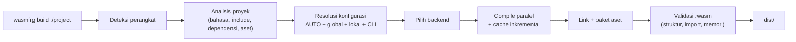
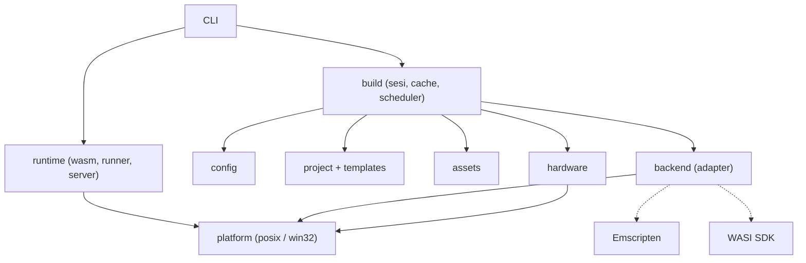

<div align="center">

<h1>🔨 WasmForge</h1>

<p><b>Toolchain C/C++ → WebAssembly yang ringan, pintar, dan sadar-perangkat.</b><br>
Satu perintah untuk memulai. Kendali penuh saat dibutuhkan.</p>

[](../../actions/workflows/build.yml)


[Fitur](#-fitur) · [Instalasi](#-instalasi) · [Penggunaan](#-penggunaan) · [Konfigurasi](#-konfigurasi) · [Struktur Folder](#-struktur-folder) · [Arsitektur](#-arsitektur) · [Troubleshooting](#-troubleshooting) · [Roadmap](#-roadmap)

</div>

---

```console
$ wasmfrg build ./project            # deteksi perangkat + proyek → konfigurasi → build → validasi
$ wasmfrg build ./project --explain  # tampilkan SETIAP keputusan otomatis beserta alasannya
$ wasmfrg dev ./project              # watch + build inkremental + server + browser reload otomatis
```

## 📖 Ringkasan

**WasmForge** (`wasmfrg`) membuat kompilasi C/C++ ke WebAssembly terasa sederhana, sementara sistem di
belakangnya bekerja keras: membaca spesifikasi perangkat, memahami struktur proyek, memilih konfigurasi,
mengelola aset, mengompilasi secara inkremental, lalu memvalidasi hasilnya.

- **Satu perintah.** `wasmfrg build ./project` — tanpa menu interaktif.
- **Bisa dijelaskan.** Setiap keputusan otomatis punya alasan (`--explain`).
- **Kendali penuh.** Mode **AUTO**, **MANUAL**, dan **HYBRID**; semuanya bisa dilihat, diubah, divalidasi, diekspor, dan di-reset.
- **Ramah perangkat kecil.** Profil `LOW-MEMORY`, batas worker dan RAM dihitung dari kondisi nyata, throttle saat memori menipis.
- **Source asli tidak pernah diubah.** Semua artefak buatan WasmForge ada di `.wasmforge/` dan `dist/`.

> [!NOTE]
> WasmForge **bukan** compiler baru. Backend yang dipakai adalah **Emscripten** (`emcc`/`em++`) dan **WASI SDK**
> (Clang/LLVM). Nilai tambah WasmForge ada di orkestrasi: deteksi perangkat, build graph, cache, aset, diagnosis,
> dan tooling pasca-build. Core tidak bergantung pada CLI Emscripten, semuanya lewat *backend adapter*.

## ✨ Fitur

<table>
<tr><td width="34%"><b>🧠 Hardware-aware</b></td><td>Arsitektur, model CPU, core (menghormati affinity), RAM total/tersedia (menghormati batas cgroup), disk, dan lingkungan: Termux, Ubuntu proot, Android, WSL, container, Windows, macOS. Tanpa root. Nilai yang tak terbaca menjadi <code>UNKNOWN</code> + strategi konservatif.</td></tr>
<tr><td><b>⚙️ Konfigurasi adaptif</b></td><td>Profil <code>AUTO</code> · <code>LOW-MEMORY</code> · <code>BALANCED</code> · <code>PERFORMANCE</code> · <code>CUSTOM</code>. Jumlah worker, batas memori, dan alokasi cache dihitung dari perangkat, bukan angka kaku.</td></tr>
<tr><td><b>🧱 Build graph + inkremental</b></td><td>Cache berbasis konten (source + header transitif + flag + versi backend). Ubah satu header → hanya file yang bergantung padanya yang dikompilasi ulang. Objek yang sukses tetap tersimpan walau build gagal.</td></tr>
<tr><td><b>🛡️ Scheduler sadar-memori</b></td><td>Sebelum menjalankan job kompilasi baru, RAM tersedia diperiksa dan job menunggu bila hampir habis — mengurangi risiko proses dimatikan Android.</td></tr>
<tr><td><b>🎮 Asset intelligence</b></td><td>Klasifikasi lewat <i>magic bytes</i> (WAD, PNG, JPEG, WAV, OGG, MP3, MIDI, WASM, ELF, PE, arsip <code>ar</code>), deteksi ekstensi yang tidak cocok, isi arsip statis (wasm vs native), dan apakah nama file dipakai di source. Byte asli tidak pernah diubah.</td></tr>
<tr><td><b>📁 Virtual filesystem</b></td><td>Aset besar (mis. WAD) disalin apa adanya ke <code>dist/assets/</code> dan dipasang ke FS Emscripten lewat loader yang dihasilkan otomatis; berjalan di browser (<code>fetch</code>) maupun Node (<code>fs</code>).</td></tr>
<tr><td><b>🧾 Header dari template</b></td><td><code>config.h</code> dibuat dari <code>config.h.cin</code> / <code>config.h.in</code> (<code>#cmakedefine</code>, <code>#cmakedefine01</code>, <code>#undef</code>, <code>@VAR@</code>) tanpa menjalankan CMake/configure dan tanpa menyentuh source.</td></tr>
<tr><td><b>🔌 Backend abstraction</b></td><td>Adapter Emscripten dan WASI SDK. Target <b>Web</b> dan <b>WASI</b> dibedakan: modul WASI ditolak sebagai output browser.</td></tr>
<tr><td><b>🔬 Analisis biner</b></td><td>Parser <code>.wasm</code> sendiri: section, import/export, memori, target Web-vs-WASI, perbandingan dua build (<code>wasm-diff</code>), dan anggaran ukuran (<code>--budget</code>).</td></tr>
<tr><td><b>🌐 Dev server</b></td><td><code>dev</code> dan <code>serve</code>: MIME <code>application/wasm</code> yang benar, Range, header COOP/COEP opsional, dan live reload.</td></tr>
<tr><td><b>🔍 Analisis proyek</b></td><td>"Blast radius" tiap header, siklus include, source terberat, <code>compile_commands.json</code> untuk clangd/IDE.</td></tr>
<tr><td><b>🔐 Aman secara default</b></td><td>Tanpa shell (argv langsung), validasi semua input, guard path traversal, server hanya di <code>127.0.0.1</code>, skrip proyek tidak pernah dijalankan otomatis.</td></tr>
</table>

## 🖥️ Platform

| Platform | Cara mendapatkan `wasmfrg` | Catatan |
|---|---|---|
| Linux x64 / ARM64 | Binary dari Releases, `scripts/setup.sh`, atau `scripts/build.sh` | Termasuk Ubuntu proot |
| Android (Termux) | `scripts/setup.sh` atau `scripts/build.sh` | Profil `LOW-MEMORY` dipilih otomatis bila RAM tipis |
| Windows x64 | Binary dari Releases atau `scripts/setup.ps1` | Win32 API native; `emcc.bat` didukung dengan validasi argumen |
| macOS ARM64 | Binary dari Releases atau `scripts/setup.sh` | |

## 📦 Instalasi

### Opsi 1 — Unduh binary siap pakai (paling cepat)

1. Buka tab **Releases** di halaman repo ini.
2. Unduh file yang sesuai dengan OS kamu:

| OS | File di Releases |
|---|---|
| Linux x64 | `wasmfrg-linux-x64` |
| Linux ARM64 (Ubuntu proot, Raspberry Pi, server ARM) | `wasmfrg-linux-arm64` |
| macOS Apple Silicon | `wasmfrg-macos-arm64` |
| Windows x64 | `wasmfrg-windows-x64.exe` |

3. Jalankan:

```bash
# Linux / macOS
chmod +x wasmfrg-linux-x64
./wasmfrg-linux-x64 version
```

```powershell
# Windows PowerShell
.\wasmfrg-windows-x64.exe version
```

Supaya bisa dipanggil sebagai `wasmfrg` dari mana saja, ganti namanya menjadi `wasmfrg` dan taruh di folder yang ada di `PATH`
(lihat [Opsi 3](#opsi-3--pasang-ke-path)).

> [!NOTE]
> - **Linux** dibangun di Ubuntu 24.04 (glibc 2.39): cocok untuk Ubuntu proot dan distro sezaman atau lebih baru.
> - **Termux langsung** (bukan proot) memakai libc Android, jadi binary Linux di atas tidak bisa dipakai di sana. Gunakan [Opsi 2](#opsi-2--build-dari-source).
> - **macOS:** binary hasil unduhan diberi karantina oleh sistem. Bila diblokir: `xattr -d com.apple.quarantine wasmfrg-macos-arm64`.

Build terbaru yang belum dirilis tersedia di tab **Actions → workflow run → Artifacts** (disimpan 14 hari).

### Opsi 2 — Build dari source

**1. Pasang prasyarat** — Git, CMake, dan compiler C++17:

| Platform | Perintah |
|---|---|
| Ubuntu / Debian / proot | `apt update && apt install -y git cmake build-essential` (tambahkan `sudo` bila bukan root) |
| Termux | `pkg install -y git cmake clang` |
| macOS | `xcode-select --install` lalu `brew install cmake` |
| Windows (PowerShell) | `winget install --id Git.Git -e`<br>`winget install --id Kitware.CMake -e`<br>`winget install --id Microsoft.VisualStudio.2022.BuildTools -e --override "--wait --passive --add Microsoft.VisualStudio.Workload.VCTools --includeRecommended"` |

> Di Windows, tutup lalu buka PowerShell baru setelah instalasi supaya `git` dan `cmake` terbaca di `PATH`.

**2. Clone dan build** — satu skrip mengonfigurasi CMake, mengompilasi, menjalankan tes, lalu menaruh hasilnya di `bin/`:

```bash
# Linux / macOS / Termux / Ubuntu proot
git clone https://github.com/USERNAME/WasmForge.git
cd WasmForge
bash scripts/setup.sh
```

```powershell
# Windows PowerShell
git clone https://github.com/USERNAME/WasmForge.git
cd WasmForge
powershell -ExecutionPolicy Bypass -File scripts/setup.ps1
```

**3. Jalankan:**

```bash
./bin/wasmfrg version          # Windows: .\bin\wasmfrg.exe version
./bin/wasmfrg doctor
```

Skrip tidak memasang paket sistem secara diam-diam dan tidak membutuhkan root.

> [!NOTE]
> `git clone` sendiri tidak bisa menjalankan setup otomatis secara portabel — Git tidak mengeksekusi skrip proyek
> setelah clone. Jalankan satu perintah setup di atas. Workflow CI juga tidak menginstal Emscripten; backend
> WebAssembly dipasang terpisah (lihat [Memasang backend](#memasang-backend)).

<details>
<summary><b>Build manual (CMake) dan tanpa CMake</b></summary>

```bash
# CMake
cmake -S . -B build -DCMAKE_BUILD_TYPE=Release -DWASMFORGE_BUILD_TESTS=ON
cmake --build build --parallel 2
ctest --test-dir build --output-on-failure

# Satu file statis (MinGW / Linux)
cmake -S . -B build -DWASMFORGE_STATIC=ON

# Tanpa CMake: hanya butuh compiler C++17 (Termux / proot / Linux / macOS)
bash scripts/build.sh            # hasil: build/wasmfrg
```

| Opsi CMake | Default | Fungsi |
|---|---|---|
| `WASMFORGE_BUILD_TESTS` | `ON` | Bangun `wf_unit_tests` dan daftarkan tes ke `ctest` |
| `WASMFORGE_STATIC` | `OFF` | Link statis (satu file `wasmfrg` / `wasmfrg.exe`) |

Di MinGW, gunakan thread model **posix** (default MSYS2); thread model `win32` tidak mendukung `std::thread`.

</details>

### Opsi 3 — Pasang ke PATH

```bash
# Linux / macOS / Termux / proot
export PATH="$PWD/bin:$PATH"          # tambahkan ke ~/.bashrc agar permanen
wasmfrg version
```

```powershell
# Windows PowerShell
$env:Path = "$PWD\bin;$env:Path"
wasmfrg version
```

### Memasang backend

WasmForge butuh minimal satu backend. Cek yang tersedia kapan saja dengan `wasmfrg doctor`.

| Backend | Target | Cara memasang |
|---|---|---|
| **Emscripten** | Browser (Web) dan WASM biasa | [emsdk](https://github.com/emscripten-core/emsdk) (di bawah) |
| **WASI SDK** | `.wasm` untuk runtime WASI (wasmtime, wasmer, Node) | Unduh [wasi-sdk](https://github.com/WebAssembly/wasi-sdk), lalu `export WASI_SDK_PATH=/path/ke/wasi-sdk` |

**Emscripten (Linux, macOS, Termux/proot):**

```bash
git clone https://github.com/emscripten-core/emsdk.git ~/emsdk
cd ~/emsdk
./emsdk install latest
./emsdk activate latest
source ~/emsdk/emsdk_env.sh          # jalankan di setiap sesi shell baru
emcc --version
```

**Emscripten (Windows PowerShell):**

```powershell
git clone https://github.com/emscripten-core/emsdk.git
cd emsdk
.\emsdk install latest
.\emsdk activate latest
.\emsdk_env.ps1
```

> [!TIP]
> Di ARM64 (HP/proot), perhatikan output `emsdk install latest`: yang diinginkan adalah **unduhan biner prebuilt**.
> Bila emsdk malah mulai mengompilasi LLVM dari source, hentikan dengan Ctrl-C karena prosesnya sangat lama.

<details>
<summary><b>📱 Termux dan Ubuntu proot (langkah lengkap)</b></summary>

**1. Di Termux — pasang Ubuntu**

```bash
pkg update && pkg upgrade
pkg install proot-distro
proot-distro install ubuntu
termux-setup-storage
proot-distro login ubuntu --bind ~/storage/downloads:/mnt/dl
```

**2. Di dalam Ubuntu — paket dasar, WasmForge, Emscripten**

```bash
apt update && apt install -y build-essential cmake git python3 xz-utils curl unzip ca-certificates
git clone https://github.com/USERNAME/WasmForge.git ~/WasmForge && cd ~/WasmForge
bash scripts/setup.sh                 # atau: bash scripts/build.sh (tanpa CMake)
export PATH="$PWD/bin:$PATH"

git clone https://github.com/emscripten-core/emsdk.git ~/emsdk
cd ~/emsdk && ./emsdk install latest && ./emsdk activate latest
source ~/emsdk/emsdk_env.sh
wasmfrg doctor
```

**3. Coba**

```bash
wasmfrg build ~/WasmForge/examples/hello-c --verify
wasmfrg dev ~/WasmForge/examples/hello-c      # buka http://localhost:8080 di browser HP
```

proot berbagi jaringan dengan Android, jadi browser HP bisa langsung membuka `localhost`.
Bila build sering berakhir `Killed`, lihat [Troubleshooting](#-troubleshooting).

</details>

## 🚀 Penggunaan

### Quick start

```bash
wasmfrg doctor                                   # 1. periksa perangkat dan backend
wasmfrg build examples/hello-c --verify          # 2. build + smoke test
wasmfrg dev examples/hello-c                     # 3. edit → rebuild otomatis → browser reload
```

### Semua perintah

| Perintah | Fungsi |
|---|---|
| `build [path]` | Analisis proyek lalu build (default path: `.`) |
| `dev [path]` | Watch + build inkremental + server dengan live reload |
| `serve [dir]` | Sajikan hasil build di `http://localhost:8080` |
| `run [path] [-- args]` | Jalankan hasil build (Node untuk output Emscripten, runtime WASI untuk `.wasm`) |
| `inspect [path]` | Tampilkan apa yang dipahami WasmForge tentang proyek dan alasannya |
| `analyze [path]` | Blast radius tiap header, siklus include, source terberat (`--touch <file>`) |
| `graph [path]` | Graf include/dependensi format Graphviz DOT |
| `gen-config [path]` | Lihat/tulis header yang dibuat dari template CMake/autotools |
| `compdb [path]` | Tulis `compile_commands.json` untuk clangd / IDE |
| `optimize [path]` | Rencana optimasi: apa yang dikerjakan, dan oleh alat mana |
| `assets inspect [path]` | Daftar file non-source dengan tipe terdeteksi (magic bytes) |
| `assets report [path]` | Keputusan untuk tiap aset beserta alasannya |
| `wasm-info <file.wasm>` | Bedah biner: section, import/export, memori, target Web vs WASI |
| `wasm-diff <a> <b>` | Bandingkan dua build: ukuran per section, import/export, memori |
| `benchmark [path]` | Ukur build dingin dan inkremental (median dari `--runs`) |
| `doctor` | Periksa mesin ini dan backend yang tersedia |
| `config show\|auto\|set\|get\|reset\|export\|import\|validate` | Kelola konfigurasi |
| `clean [path]` | Hapus `.wasmforge/` dan `dist/` (`--cache`: hanya cache objek) |
| `version` · `help` | Versi dan bantuan |

### Contoh alur kerja

```bash
# Lihat dulu apa yang akan terjadi, tanpa menjalankan apa pun
wasmfrg build ./game --dry-run --explain

# Build dengan pilihan eksplisit
wasmfrg build ./game --profile low-memory --workers 2 --strategy compact --html

# Beberapa main() di satu proyek? Pilih satu, atau kecualikan sisanya
wasmfrg build ./game --entry src/main.c
wasmfrg build ./game --exclude 'setup/*' --exclude '*_test.c'

# Header hasil generate CMake (config.h) tanpa CMake
wasmfrg build ./game --var PACKAGE_VERSION=1.2.3 --var HAVE_LIBPNG=0

# Setelah build
wasmfrg wasm-info game/dist/game.wasm --web      # bedah biner
wasmfrg build ./game --budget 2MB                # gagal bila .wasm > 2 MB
wasmfrg run ./game --timeout 10 -- --help        # jalankan di Node / runtime WASI
wasmfrg serve ./game --isolate                   # + header COOP/COEP untuk wasm threads

# Analisis
wasmfrg analyze ./game --touch src/types.h       # apa yang dikompilasi ulang bila types.h diubah?
wasmfrg compdb ./game                            # untuk clangd: --compile-commands-dir=game/.wasmforge
wasmfrg wasm-diff old.wasm new.wasm              # perubahan ukuran per section
```

### Opsi umum

| Opsi | Keterangan |
|---|---|
| `--profile <p>` | `auto` · `low-memory` · `balanced` · `performance` · `custom` |
| `--workers <n>` · `--memory <MB>` | Jumlah job paralel · anggaran memori build |
| `--strategy <s>` | `intelligent` · `compact` · `execution` · `memory` · `balanced` · `none` |
| `--assets <m>` | `auto` · `preserve` · `embed` · `external` |
| `--output <o>` | `web` · `wasm` · `runtime` |
| `--backend <b>` | `auto` · `emscripten` · `wasi-sdk` |
| `--name <nama>` · `--html` | Nama output · sertakan HTML shell |
| `--out <dir>` | Direktori output (default `<path>/dist`) |
| `--entry <file>` | Entry point bila beberapa file memiliki `main()` |
| `--exclude <glob>` | Lewati source yang cocok (boleh diulang) |
| `--asset <glob>` | Sertakan file yang cocok walau tidak dirujuk source (boleh diulang) |
| `--define <X[=Y]>` | Define preprocessor (boleh diulang) |
| `--var <NAME[=V]>` | Nilai untuk header hasil generate template (boleh diulang) |
| `--flag <flag>` | Flag backend tambahan untuk compile dan link (tidak lewat shell) |
| `--budget <ukuran>` | Gagalkan build bila `.wasm` melebihi ukuran, mis. `2MB` |
| `--explain` · `--dry-run` | Jelaskan keputusan · tampilkan perintah backend tanpa menjalankannya |
| `--verify` · `--timeout <s>` | Smoke test setelah build · batas waktu (default 10 s) |
| `--force` · `--keep-going` | Abaikan cache · lanjut walau ada file gagal |
| `--port` · `--bind` · `--isolate` | Opsi `serve`/`dev`: port (0 = bebas) · alamat IPv4 · COOP/COEP |
| `--interval <ms>` | Opsi `dev`: interval polling (100–10000) |
| `--verbose`, `-v` · `--web` · `--local` | Detail · `wasm-info` sebagai target browser · `config` ke `./wasmforge.ini` |

### Kode keluar

| Kode | Arti |
|---|---|
| `0` | Berhasil |
| `1` | Build / runtime gagal |
| `2` | Salah pakai (perintah/opsi tidak dikenal) |
| `3` | Masalah lingkungan (backend tidak ada) |
| `4` | Kesalahan konfigurasi |

## 🎛️ Konfigurasi

Konfigurasi berlapis — yang kanan menang:

```
AUTO  <  config global  <  ./wasmforge.ini (proyek)  <  opsi baris perintah
```

| Mode | Cara |
|---|---|
| **AUTO** | Tidak melakukan apa-apa. WasmForge menentukan semuanya dari perangkat dan proyek. |
| **MANUAL** | `wasmfrg config set profile custom` + `workers`, `memory`, dst. |
| **HYBRID** | Ganti sebagian saja: `wasmfrg config set workers 2` — sisanya tetap AUTO. |

```bash
wasmfrg config show                    # nilai efektif + sumber + alasan
wasmfrg config set workers 2           # simpan ke config global
wasmfrg config set --local profile low-memory   # simpan ke ./wasmforge.ini
wasmfrg config auto                    # kembali otomatis (profile/workers/memory)
wasmfrg config export > mine.ini       # ekspor · impor: wasmfrg config import mine.ini
wasmfrg config validate                # periksa isi file
wasmfrg config reset                   # hapus semua pengaturan
```

| Lokasi file | Path |
|---|---|
| Global | `~/.config/wasmforge/config.ini` (atau `$XDG_CONFIG_HOME/wasmforge/`) · Windows: `%APPDATA%\WasmForge\config.ini` |
| Proyek | `./wasmforge.ini` |

<details>
<summary><b>Kunci konfigurasi</b></summary>

| Kunci | Nilai |
|---|---|
| `profile` | `auto` · `low-memory` · `balanced` · `performance` · `custom` |
| `workers` | 1–256 |
| `memory` | 128–1048576 (MB) |
| `strategy` | `intelligent` · `compact` · `execution` · `memory` · `balanced` · `none` |
| `assets` | `auto` · `preserve` · `embed` · `external` |
| `output` | `web` · `wasm` · `runtime` |
| `backend` | `auto` · `emscripten` · `wasi-sdk` |
| `html` | `true` · `false` |
| `name` | huruf, angka, `-`, `_` |

Contoh `wasmforge.ini`:

```ini
profile = balanced
workers = 2
strategy = compact
html = true
```

</details>

<details>
<summary><b>Bagaimana profil AUTO memutuskan</b></summary>

| Profil | Dipilih bila | Worker | Anggaran memori | Strategi (`intelligent`) | Cache |
|---|---|---|---|---|---|
| `LOW-MEMORY` | RAM tersedia < 2 GB (< 3 GB di Android), atau RAM/core `UNKNOWN` | ≤ 2 | 35% RAM (maks 1,5 GB) | `compact` | 256 MB |
| `BALANCED` | selain dua lainnya | ½ core | 50% RAM (maks 8 GB) | `balanced` | 1 GB |
| `PERFORMANCE` | ≥ 8 core dan ≥ 8 GB RAM | core − 1 | 70% RAM (maks 16 GB) | `execution` | 2 GB |

Jumlah worker selalu dibatasi anggaran memori ÷ estimasi per job (≈ 700 MB untuk C++, ≈ 350 MB untuk C),
dan cache dibatasi 25% ruang disk kosong.

</details>

### Strategi optimasi

| Strategi | Flag Emscripten | Cocok untuk |
|---|---|---|
| `none` | `-O0` | Debug, build tercepat |
| `balanced` | `-O2` | Kompromi kecepatan/ukuran |
| `execution` | `-O3` | Performa runtime |
| `compact` | `-Oz` + `-ffunction-sections -fdata-sections` | Ukuran terkecil |
| `memory` | `-Os` + sections | Tekanan RAM compiler lebih rendah |
| `intelligent` | dipilih dari profil | Default |

Optimasi (constant folding, dead-code elimination, inlining, dst.) dikerjakan oleh pipeline LLVM dan Binaryen
milik backend; WasmForge memilih strategi dan meneruskan flag. `wasmfrg optimize` menampilkan rincian pembagian tugasnya.

### Aset

WasmForge tidak mengubah semua file menjadi WASM/JS. File data tetap berformat aslinya.

| Jenis | Keputusan otomatis |
|---|---|
| WAD, gambar, audio, MIDI, JSON, teks | Dirujuk nama filenya di source (atau `--asset`) → ≤ 32 KB dan bukan WAD: **EMBED**; selain itu: **EXTERNAL** (disalin ke `dist/assets/` dan dipasang ke VFS) |
| Tidak dirujuk source | **SKIP** (paksa dengan `--asset <glob>`) |
| Dokumen (README, LICENSE, `.md`), file build | **SKIP** |
| Arsip statis `.a` berisi objek wasm/bitcode | **LINK** |
| `.so`, `.dll`, ELF/PE native | **SKIP** (tidak bisa dipakai WebAssembly) |

Strategi `--assets`: `auto` · `preserve` · `embed` · `external`. Lihat keputusan per file: `wasmfrg assets report`.

### Header dari template (`gen-config`)

Bila sebuah `#include "config.h"` tidak ditemukan dan ada template yang cocok (`*.h.cin`, `*.h.in`, `*.h.cmake`),
WasmForge membuatnya di `.wasmforge/gen/include/` — **source dan template asli tidak disentuh**. Setiap nilai
diberi asal-usul:

| Asal | Arti |
|---|---|
| `user` | Dari `--var NAME=VALUE` |
| `derived` | Dari dependensi yang terdeteksi dan didukung backend |
| `guess` | Diasumsikan ada di libc wasm (tidak diprobe) |
| `placeholder` | Butuh nilai dari kamu (mis. `PACKAGE_VERSION`) |
| `unset` | Tidak diprobe |

```console
$ wasmfrg gen-config examples/cmake-style --dry-run --var PROJECT_VERSION=2.1.0 --var ENABLE_SOUND=1
config.h  <-  config.h.cin  (included by 1 file(s); written to .wasmforge/gen/include/config.h)
    [on ] ENABLE_SOUND                cmakedefine01  = 1              (user)
    [on ] HAVE_DIRENT_H               cmakedefine    = 1              (guess)  assumed present in the wasm libc sysroot (not probed)
    [on ] HAVE_LIBPNG                 cmakedefine    = 1              (derived)  a source includes its header and the backend can supply it
    [off] HAVE_LIBSAMPLERATE          cmakedefine    = (undefined)    (derived)  used by the sources but the backend has no wasm port of it
    [off] WORDS_BIGENDIAN             cmakedefine    = (undefined)    (derived)  WebAssembly is little-endian
    ...
```

### Dependensi → flag Emscripten

| Header terdeteksi | Flag |
|---|---|
| `SDL.h`, `SDL2/…` | `-sUSE_SDL=2` |
| `SDL_mixer.h` | `-sUSE_SDL_MIXER=2` |
| `SDL_net.h` · `SDL_image.h` · `SDL_ttf.h` | `-sUSE_SDL_NET=2` · `-sUSE_SDL_IMAGE=2` · `-sUSE_SDL_TTF=2` |
| `zlib.h` · `png.h` · `jpeglib.h` | `-sUSE_ZLIB=1` · `-sUSE_LIBPNG=1` · `-sUSE_LIBJPEG=1` |
| `ft2build.h` · `ogg/` · `vorbis/` | `-sUSE_FREETYPE=1` · `-sUSE_OGG=1` · `-sUSE_VORBIS=1` |
| `pthread.h` | dilaporkan saja; thread tidak diaktifkan otomatis (`--flag -pthread` bila memang dipakai) |
| `windows.h`, `X11/`, `curl/`, `openssl/`, `samplerate.h`, `fluidsynth.h` | didiagnosis sebagai tidak didukung backend |

Port Emscripten diunduh dan di-cache oleh Emscripten saat pertama kali dipakai (butuh internet satu kali).

### Format output

```
dist/
├── <nama>.js            # glue Emscripten (target web / runtime)
├── <nama>.wasm          # modul WebAssembly
├── <nama>.html          # hanya dengan --html
├── assets/              # aset EXTERNAL, format asli
└── manifest.json        # daftar file, ukuran, hash, dan pemasangan aset
```

| `--output` | Isi |
|---|---|
| `web` | Paket browser: `.js` + `.wasm` (+ `.html`) + `assets/` + `manifest.json` |
| `runtime` | `.wasm` + glue JS + resource yang dibutuhkan |
| `wasm` | Hanya `<nama>.wasm` (standalone), tanpa file tambahan |

`manifest.json` (bentuk skema):

```json
{
  "name": "game",
  "generator": "wasmfrg 0.1.0",
  "backend": "emscripten <versi emcc>",
  "target": "web",
  "entry": "game.js",
  "files":  [{ "path": "game.wasm", "bytes": 0, "fnv1a64": "…" }],
  "assets": [{ "source": "data/doom1.wad", "path": "assets/data/doom1.wad",
               "mount": "/data/doom1.wad", "mode": "external", "kind": "wad", "bytes": 0 }]
}
```

## 🗂️ Struktur Folder

```
WasmForge/
├── CMakeLists.txt              # build system (library inti, wasmfrg, unit tests, ctest)
├── README.md
├── LICENSE                     # MIT
├── .github/workflows/build.yml # CI: Linux x64/ARM64, macOS ARM64, Windows x64 + Release binaries
├── .gitignore
│
├── src/
│   ├── main.cpp                # entry point (Windows: argumen UTF-16 → UTF-8)
│   ├── cli/                    # parsing argumen, subcommand, bantuan, kode keluar
│   ├── core/                   # util (hash, path guard, glob, JSON escape), diagnostik
│   ├── platform/               # lapisan OS: platform_posix.cpp · platform_win32.cpp
│   ├── hardware/               # deteksi CPU/RAM/disk/lingkungan (tanpa root)
│   ├── config/                 # lapisan konfigurasi AUTO/MANUAL/HYBRID + resolusi adaptif
│   ├── project/                # discovery, scan #include, build graph, generator header dari template
│   ├── assets/                 # klasifikasi magic bytes + keputusan EMBED/EXTERNAL/LINK/SKIP
│   ├── backend/                # abstraksi Backend + adapter Emscripten dan WASI SDK
│   ├── build/                  # sesi, cache inkremental, scheduler, packaging, analisis, compdb
│   ├── runtime/                # parser .wasm · runner (Node/WASI + timeout) · server HTTP
│   └── diagnostics/            # wasmfrg doctor
│
├── tests/
│   ├── unit/                   # test_main.cpp — tes unit tanpa dependensi eksternal
│   └── integration/            # run.sh, backend uji (fake-emcc.sh), wasmgen.py, loader_test.js
│
├── examples/
│   ├── hello-c/                # proyek C dengan header
│   ├── hello-cpp/              # proyek C++ dengan subfolder header
│   └── cmake-style/            # config.h.cin + #cmakedefine (uji gen-config)
│
├── scripts/
│   ├── setup.sh                # configure + build + tes + salin ke bin/   (POSIX)
│   ├── setup.ps1               # configure + build + tes + salin ke bin/   (Windows)
│   ├── build.sh                # build tanpa CMake (hanya compiler C++17)
│   └── test.sh                 # build + unit + integrasi
│
└── docs/
    ├── architecture.md         # alur dan batasan desain
    ├── windows.md              # detail implementasi Win32
    └── status.md               # status pengembangan per kriteria
```

Folder yang dibuat saat dipakai (sudah ada di `.gitignore`):

```
bin/                    # binary hasil setup.sh / setup.ps1
build/                  # artefak CMake
<proyek>/dist/          # output build proyek kamu
<proyek>/.wasmforge/
├── cache/              # objek hasil kompilasi (content-addressed) + .meta integritas
├── gen/                # vfs-preload.js · include/ (header hasil template) · run-wasi.js
└── compile_commands.json
```

## 🏗️ Arsitektur





Aturan desain: modul `core`, `config`, `project`, `assets`, dan `build` **tidak pernah** menyebut `emcc` atau `clang`.
Hanya `backend/` yang tahu cara memanggil toolchain, sehingga menambah backend baru cukup dengan mengimplementasikan
kelas `Backend`. Detail lengkap: [docs/architecture.md](docs/architecture.md).

## 🔐 Keamanan

| Risiko | Penanganan |
|---|---|
| Command injection | Tidak ada shell. Argumen diteruskan sebagai argv (`fork/execvp`, `CreateProcessW`). Launcher `.bat` di Windows menolak argumen berisi `" % ^ & \| < > !`. |
| Path traversal | Semua penulisan di luar direktori output/`.wasmforge` ditolak; `clean` hanya menghapus di dalam proyek; include string tidak pernah menentukan lokasi tulis. |
| Input berbahaya | Parser `.wasm` dibatasi bounds dan diuji dengan mutasi acak di bawah ASan/UBSan; nilai konfigurasi divalidasi. |
| Proses menggantung | Timeout membunuh seluruh process group (POSIX). |
| Cache rusak | Setiap objek punya `.meta` ukuran; objek ditulis ke file sementara lalu di-rename; cache dipangkas LRU. |
| Server lokal | Default `127.0.0.1`; guard traversal (termasuk ter-encode) dan symlink keluar folder; cek header `Host` (anti DNS-rebinding); batas ukuran request dan jumlah koneksi. |
| Skrip proyek | Tidak pernah dijalankan otomatis. |

## 🧪 Pengujian dan CI

```bash
bash scripts/test.sh                          # build + 157 tes unit + 90 tes integrasi
ctest --test-dir build --output-on-failure    # lewat CMake
```

- **Unit** (`tests/unit/test_main.cpp`): util, konfigurasi, discovery proyek, aset, backend, parser wasm (termasuk fuzzing mutasi), server, template, `wasm-diff`.
- **Integrasi** (`tests/integration/run.sh`): build, cache inkremental, kegagalan, dry-run, konfigurasi berlapis, `run`/`--verify`, loader VFS (Node + stub browser), server HTTP (curl), `dev` + live reload, header dari template, `analyze`/`compdb`/`--budget`/`wasm-diff`.
- **Backend uji:** `fake-emcc.sh` meniru kontrak argumen `emcc` agar logika cache/scheduler/packaging dapat diuji di mana saja; modul `.wasm` uji dirakit oleh `wasmgen.py` dan divalidasi silang dengan `WebAssembly.validate` milik Node.
- **Sanitizer:** suite yang sama dijalankan di bawah ASan, UBSan, dan TSan.
- **CI** ([`build.yml`](.github/workflows/build.yml)): Configure → Compile → `ctest` → unggah artifact; tag `v*` menerbitkan binary (nama unik per platform) ke Releases.

## 🩺 Troubleshooting

<details>
<summary><code>E-NOBACKEND</code> — backend tidak ditemukan</summary>

Aktifkan Emscripten di shell ini: `source ~/emsdk/emsdk_env.sh` (Windows: `.\emsdk_env.ps1`), lalu `wasmfrg doctor`.
Untuk WASI SDK, set `WASI_SDK_PATH`. Pilih backend eksplisit dengan `--backend emscripten` atau `--backend wasi-sdk`.

</details>

<details>
<summary><code>E-MULTIMAIN</code> — beberapa file memiliki <code>main()</code></summary>

Proyek memuat beberapa program (mis. game + tool setup). Pilih satu: `--entry src/main.c`, atau kecualikan
sisanya: `--exclude 'setup/*'`. `wasmfrg inspect` menampilkan daftar entry point.

</details>

<details>
<summary><code>W-MISSING-INCLUDE</code> — header seperti <code>config.h</code> tidak ditemukan</summary>

Biasanya header itu dibuat oleh CMake/autotools. Bila ada template (`config.h.cin` / `config.h.in`), WasmForge
membuatnya sendiri — lihat `wasmfrg gen-config`. Atur nilainya dengan `--var NAME=VALUE`. Bila tidak ada template,
sediakan header itu di proyek atau tambahkan `--flag -I<dir>`.

</details>

<details>
<summary><code>E-WASM-WASI-IN-WEB</code> — modul mengimpor fungsi WASI</summary>

Browser tidak menyediakan import WASI. Bangun dengan backend Emscripten untuk output browser, atau jalankan
modul itu di runtime WASI (`wasmfrg run`, wasmtime, wasmer).

</details>

<details>
<summary>Build berakhir <code>Killed</code> (RAM habis / Android mematikan proses)</summary>

```bash
wasmfrg build ./project --workers 1 --profile low-memory
termux-wake-lock          # Termux: cegah sistem menidurkan proses
```

Di Android 12+, proses latar belakang bisa dimatikan sistem (cari: *phantom process killer*). Objek yang sudah
berhasil dikompilasi tersimpan di cache, jadi menjalankan ulang hanya mengerjakan sisanya.

</details>

<details>
<summary>Link gagal: <i>undefined symbol</i></summary>

Biasanya ada file khusus platform lain yang ikut dikompilasi, atau library belum tersedia. Kecualikan file itu
(`--exclude`), tambahkan library lewat `--flag`, dan periksa peringatan `W-DEP` pada output.

</details>

<details>
<summary>Windows: argumen ditolak oleh launcher <code>emcc.bat</code></summary>

File `.bat` hanya bisa dijalankan lewat `cmd.exe`, yang mem-parse ulang baris perintah. Demi keamanan, argumen berisi
`" % ^ & | < > !` ditolak. Gunakan emsdk yang memanggil `python emcc.py` langsung, atau WSL.

</details>

<details>
<summary>Port <code>8080</code> sudah dipakai</summary>

`wasmfrg serve ./project --port 0` memilih port bebas dan mencetak URL-nya.

</details>

## 🗺️ Roadmap

- [x] CLI, arsitektur modular, deteksi perangkat, konfigurasi AUTO/MANUAL/HYBRID, backend abstraction
- [x] Discovery proyek, build graph, cache inkremental, scheduler sadar-memori
- [x] Asset intelligence, loader VFS, `manifest.json`
- [x] Header dari template CMake/autotools
- [x] Parser `.wasm`, `run`/`--verify`, `serve`/`dev` dengan live reload
- [x] `analyze`, `compdb`, `wasm-diff`, anggaran ukuran
- [ ] Integrasi Chocolate Doom: SDL2, audio, input keyboard/mouse, paket WAD
- [ ] *Bridge mode* untuk proyek CMake/autotools penuh (dengan persetujuan pengguna)
- [ ] Backend ringan Clang + `wasm-ld` tanpa Emscripten
- [ ] Profiling, optimasi memori, dan benchmark pembanding antar-toolchain

## 📚 Dokumentasi

- [docs/architecture.md](docs/architecture.md) — alur build dan batasan desain
- [docs/windows.md](docs/windows.md) — implementasi native Windows
- [docs/status.md](docs/status.md) — status pengembangan per kriteria

## 🚢 Merilis versi (untuk maintainer)

Bagian ini untuk pemilik repo, bukan untuk pengguna. Merilis versi baru cukup dengan satu tag:

```bash
git tag v0.1.0
git push origin v0.1.0
```

GitHub Actions lalu membangun keempat platform dan melampirkan binary berikut ke **Releases**:
`wasmfrg-linux-x64`, `wasmfrg-linux-arm64`, `wasmfrg-macos-arm64`, dan `wasmfrg-windows-x64.exe`.
Push biasa (tanpa tag) hanya menghasilkan artifact di tab Actions.

## 🤝 Kontribusi

1. Fork dan buat branch: `git checkout -b fitur/nama-fitur`
2. Jalankan `bash scripts/test.sh` — semua tes harus lulus
3. Tambahkan tes untuk perubahan perilaku (unit di `tests/unit/`, alur CLI di `tests/integration/run.sh`)
4. Buka Pull Request

Menambah backend baru: implementasikan `Backend` di `src/backend/backend.cpp` lalu daftarkan di `backendIds()` dan `makeBackend()`.

## 📄 Lisensi

[MIT](LICENSE)
